# access-log-hunter

Every public web server is probed all day: SQL injection, path traversal, log4shell, scanners hunting for `.env` files. access-log-hunter reads an access log and tells you which IPs are attacking, with what, and how hard.



**Live demo:** https://jvch0512.github.io/access-log-hunter/ (a report on the synthetic log in `examples/`)

Lua 5.4, no dependencies, about 150 lines of logic.

## Use

```bash
lua5.4 bin/access-log-hunter /var/log/nginx/access.log
lua5.4 bin/access-log-hunter access.log --html > report.html
lua5.4 bin/access-log-hunter access.log --min-score 10 --fail-on-find   # exit 1 in a pipeline
```

Works on the combined log format (nginx and Apache defaults). Requests are URL-decoded twice, so double-encoded payloads are caught.

| Category | Examples |
|---|---|
| sqli | UNION SELECT, `OR 1=1`, `SLEEP()`, `information_schema`, `extractvalue` |
| xss | `<script`, `onerror=`, `javascript:` |
| traversal | `../../`, `/etc/passwd`, double-encoded variants |
| rce | `${jndi:`, `cmd=`, `; wget`, `/bin/sh` |
| recon | `/.env`, `/.git/config`, `/phpmyadmin`, `/actuator/` |
| scanner | sqlmap, nikto, nuclei, gobuster and others in the user agent |

Each IP gets a score, an `error-storm` flag when more than 80% of 20 or more requests fail, and a severity.

See [examples/access.log](examples/access.log) (built by `make_log.lua`) and [docs/sample-output.txt](docs/sample-output.txt).

## Limits

- Pattern based, on the request line and user agent only. No request bodies, no response sizes, no timing analysis.
- Expect noise from scanners you run yourself and from unusual but legitimate query strings. Tune with `--min-score`.
- A WAF blocks attacks, this tells you who is trying. It does not know whether an attack succeeded, only the status code.

## Where it fits

Quick triage on a web server after an alert, a fixed-price "web exposure review" for small companies, and a blue-team exercise on real logs.

## Tests

```bash
make test    # 25 checks, including a 2000-line random-input fuzz
```

MIT.
